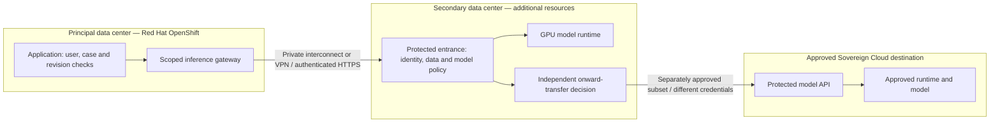

# Secondary GPU services and governed cloud burst

## Scope and current status

The principal data center runs the Primary AI Lab on Red Hat OpenShift. A second data center supplies additional resources through protected services. Only the secondary center can request separately approved onward processing from Sovereign Cloud. The secondary platform is not assumed to run OpenShift or the complete OpenShift AI product.

The existing `lab/deployment_policy.py` provides fail-closed planning checks. It explicitly states that no live remote connector is enabled. The local inference gateway refuses remote fallback. No secondary GPU service, MCP server, private interconnect or sovereign-cloud deployment has been accepted.



Responses return through the same chain. There is no direct primary-to-cloud route. A request permitted at the secondary on-premises service may still be forbidden in cloud.

## First milestone — install the secondary on-premises service

1. **GPU host and execution support.** Confirm the actual accelerator, memory, operating system, driver and model-runtime compatibility. A standalone containerized NVIDIA server needs its driver and NVIDIA Container Toolkit. A supported Kubernetes/OpenShift deployment can use NVIDIA GPU Operator and cluster scheduling instead. Do not install both approaches by default.
2. **Pinned model runtime.** Deploy a task-compatible serving container and approved model revision. vLLM is an option for text generation. KServe can manage model deployments on a cluster. Verify the model identity and runtime image. BGE-M3 produces retrieval vectors. Qwen3:4b generates text from supplied context. Changing the embedding model or revision requires an explicit index compatibility and migration decision.
3. **Protected service entrance.** Restrict network reachability to the approved gateway. Configure trusted TLS certificates, workload authentication, model permissions, request size, concurrency and consumption limits. The raw model endpoint must not bypass those controls.
4. **Storage and secrets.** Store weights separately from project data. Scope service credentials to the required resources. Do not provide general access to the principal case database. Define temporary input/output retention and verified deletion. Do not log document or prompt content by default.
5. **Operating controls.** Provide health checks, metrics, correlation identifiers, queue limits, deadlines and a recovery procedure. Retain request decisions without exposing credentials. Queue or reject requests when approved capacity is unavailable.
6. **Transfer policy.** Disable onward cloud processing until a specific destination, model, dataset scope, operator and retention policy have separate approval.

## Configure the connection from OpenShift

The network teams configure the private interconnect or approved VPN, private DNS, routes and firewall rules. The primary gateway workload may connect to the secondary HTTPS entrance. The secondary entrance may reach its model runtime. Return traffic uses the established connection. Cluster administration interfaces and shared filesystem access are not required.

The connector must receive a fixed service address, trusted certificate chain, authentication reference, approved model identifier, API schema, deadline and budget. The following is a **proposed configuration contract**, not configuration already parsed or implemented by the lab:

```yaml
secondary_service:
  enabled: false
  endpoint: https://approved-secondary-service.example/inference
  trust_bundle_ref: approved-secondary-ca
  credential_ref: project-scoped-secondary-credential
  model_revision_ref: approved-pinned-model
  transfer_policy_ref: secondary-destination-policy
  request_timeout_seconds: 60
  max_in_flight: 1
  onward_cloud_allowed: false
```

Real endpoint names, secrets, limits and model revisions are supplied by the receiving operator. Never put secret values in this file or in a prompt. A TLS connection authenticates the server. Mutual TLS can authenticate workloads. Destination-bound access tokens authorize the configured operation. The downstream service validates its own audience and scope.

For generation, retrieve current authorized passages locally and send only the permitted question/context/citation identifiers. Recheck permissions and source revisions when the result returns. A project ID from a client request is not proof of authorization. The remote runtime receives no implicit right to query every project. Training requires a separate job submission, approved dataset and artifact-return contract.

## Quota administration and usage interface

An authorized operator configures the project, model, destination, accounting period, total token budget, input/output ceilings, concurrency and queue limits. An Officer can inspect allowance for permitted projects but cannot increase it or approve destinations. The view shows consumed, reserved and remaining allowance, model, destination, period and refusal reason without exposing document content.

Before dispatch, the gateway checks data eligibility and model rights, counts input tokens using the selected tokenizer and atomically reserves allowance for the bounded request. Concurrent requests must not each spend the same balance. After execution, it reconciles actual usage, releases unused allowance and applies defined failure, cancellation and duplicate-request charging rules. Word or character counts are not exact model-token counts.

An operation using passages from several projects must identify an approved funding budget and satisfy each source's transfer policy. Access to multiple projects does not merge budgets or permit spending another project's allowance. The secondary gateway checks a separate cloud budget and approval before onward processing. Available tokens never override a data-transfer refusal.

Speech can use audio-duration budgets. Training needs job, dataset and compute limits. GPU time and concurrency are separate measures. Authentication access tokens are credentials, not consumption units.

This remote quota interface and accounting contract are **requirements, not an implemented or accepted feature**. Local gateway limits do not establish remote reservation or cloud reconciliation acceptance.

## API and MCP are different layers

A direct protected inference API is sufficient for the first pilot. An OpenAI-compatible API describes a request format, not a requirement to use a public inference provider.

If the consuming application requires Model Context Protocol, install an MCP client in the lab and a protected MCP facade in the secondary center. The facade exposes only approved tools, such as generation from supplied approved passages. It validates actor, project, operation and payload, then uses its own appropriately scoped authority to call the model service. It does not expose unrestricted files, shell commands or project search.

For protected HTTP MCP, follow the applicable authorization specification, including resource discovery, scope handling and audience validation. Do not pass a token intended for the MCP server to a separate model service. MCP does not supply GPUs, network isolation or data-transfer permission.

## Second milestone — connect the secondary center to Sovereign Cloud

The destination needs compatible model serving, compute, controlled weights and data storage, a protected entrance, identities, quotas, retention enforcement and operating evidence. Connect it from the secondary gateway with a separately approved route and credentials. Do not infer eligibility from a sovereign label, private connectivity or approval of the first hop.

For each data category, the owner must approve the actual receiving service, operator, processing location, permitted model, input subset, logging, retention and any further transfers. Fictional lab data is the initial acceptance corpus. Internal, restricted or personal data stays blocked without the required destination-specific approval. Removing names alone does not establish anonymity.

## Acceptance before activation

- An approved fictional request executes on the pinned secondary model and returns verifiable provenance.
- Invalid or revoked credentials, wrong projects, prohibited models, excess budgets, expired approvals and altered inputs fail.
- Certificate failure, timeout, duplicate requests, exhausted GPU memory and service unavailability preserve local state and never silently route to cloud.
- A cloud-eligible request follows the secondary service's independent decision. On-premises-only data cannot use that path.
- The teams verify logging, retention, deletion, recovery, result permissions and the absence of a direct primary-to-cloud route.

## Official references

- [NVIDIA GPU Operator overview](https://docs.nvidia.com/datacenter/cloud-native/gpu-operator/latest/overview.html)
- [Red Hat OpenShift AI inference endpoints and authentication](https://docs.redhat.com/en/documentation/red_hat_openshift_ai_self-managed/3.3/html/deploying_models/making_inference_requests_to_deployed_models)
- [Model Context Protocol authorization](https://modelcontextprotocol.io/specification/latest/basic/authorization)
