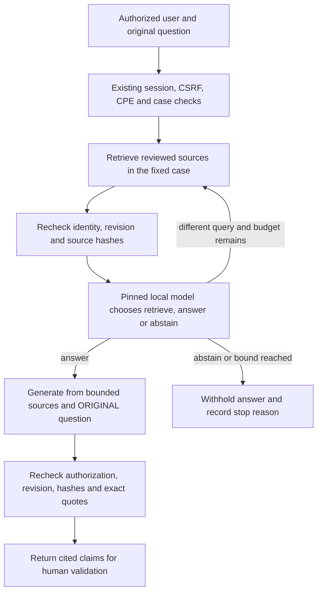

# AI Engineering laboratory

This extension adds three executable engineering exercises and one evidence gate to the existing case-processing lab. Every example is synthetic. Executed code, measured behavior and human approval remain separate.

## Read and reproduce the code

- [Runbook](RUNBOOK.md): preparation, model pins, database access, each measurement, interpretation, errors and cleanup.
- [Complete function index](FUNCTION_INDEX.md): every scoped class, named function, method, nested helper and associated test, linked to its source contract.
- [Search reference](search-reference.md): TF-IDF, BGE-M3/pgvector, pinned inference, access/revision checks and the comparison/gate scripts.
- [Vision reference](vision-reference.md): models, cache, queues, HTTP handlers, timing and load procedures.
- [Explanation and acceptance reference](explainability-acceptance-reference.md): inputs, numerical scales, SHAP/LIME checks, model comparison and evidence-gate contracts.
- [Portal reference](portal-reference.md): every optional API route, browser procedure, event handler and callback.

Run `python -B scripts/check_engineering_documentation.py` to check coverage. Documentation describes the current implementation and its known failures; it does not implement the planned identifier-chain correction.

| Exercise | User-visible function | Application components | Actual execution scope |
| --- | --- | --- | --- |
| Bounded agentic search | Refine a search when reviewed evidence is insufficient, then answer or abstain | `AgenticSearch`, a reviewed-source retriever, pinned `LocalInference`, existing case/session controls | Local Ollama CPU generation was measured with reviewed-only lexical retrieval, then with BGE-M3 + pgvector on the local OKD cluster. A two-step question failed with both and blocks the gate. No cluster model serving is exercised. |
| Vision performance | Compare model-call, pipeline and service timing; observe batching, queues, precision and worker effects | `VisionPredictor`, `BoundedBatchVisionService`, temporary loopback HTTP services | An earlier tiny trained classifier and a separate ResNet-shaped load probe have different scopes. Random-weight timing never proves image-classification quality. |
| Individual explanations | Compare a linear baseline and a tree model; inspect SHAP reconstruction and LIME fidelity | `run_explainability_comparison`, scikit-learn, SHAP and LIME | Native CPU, one fixed synthetic split. Numerical reconstruction can pass while a local explanation fails its fidelity diagnostic. |
| Candidate evidence gate | Show pass, fail and review-pending checks before a separate human decision | `evaluate_candidate_evidence` | Pure in-memory checks and content hashes. A failed or missing two-step search case blocks. No registry release or production approval is performed. |

## Search control and architecture



One model controls one agent. It cannot select an actor, another case, a destination or a new tool. At most three retrievals and three reviewed chunks, totaling at most 4,500 characters, enter the evidence window. Repeated queries, source changes, invalid plans, unavailable models and expired deadlines stop the controller. The trace contains actions, queries and source hashes, not a reasoning transcript.

`LocalInference.request_budget` carries the remaining deadline and authorization guard to model-verification, planning, embedding and generation HTTP requests. Phase timeouts are capped and late output is rejected; this does not cancel model computation already running on the server or a database query. The CPU measurement explicitly used `num_gpu=0`, a 4,096-token context cap, a 384-token generation cap and `keep_alive=0`.

The reviewed-only lexical adapter uses the authoritative case sources and excludes the older demonstration's synthetic procedure cards. The existing vector retriever is the second backend: BGE-M3 encodes each reviewed passage once and each query, and pgvector stores the vectors with their case, revision, content hash and model digest. The 28 October comparison ran it against a pgvector pod on the local OKD cluster; that is not a deployment acceptance.

## Source map

| Source | Responsibility |
| --- | --- |
| [`agentic_search.py`](../../lab/agentic_search.py) | `AgenticSearch.answer` and `ReviewedLexicalRetriever`; fixed identity/case, bounded loop, source integrity and action trace |
| [`local_inference.py`](../../lab/local_inference.py) | Pinned local models, strict search-action parsing, request budgets and cited generation |
| [`vector_retrieval.py`](../../lab/vector_retrieval.py) | Existing reviewed-source extraction, source hashes and optional revision-scoped pgvector retrieval |
| [`engineering_vision.py`](../../lab/engineering_vision.py) | Synthetic classifiers, cache invalidation, bounded batch service and open-loop HTTP measurement |
| [`engineering_explainability.py`](../../lab/engineering_explainability.py) | Synthetic training, linear/tree comparison and actual SHAP/LIME calculations |
| [`engineering_acceptance.py`](../../lab/engineering_acceptance.py) | Pure laboratory evidence checks and canonical JSON SHA-256 hashes |
| [`engineering_api.py`](../../lab/engineering_api.py) | Optional routes over the existing authentication, case and CPE controls |
| [`compare_agentic_retrieval.py`](../../scripts/compare_agentic_retrieval.py) | Same agent and Qwen3:4b with TF-IDF or BGE-M3 + pgvector, retrieval-only ranks, guard and persistence checks |
| [`gate_agentic_retrieval.py`](../../scripts/gate_agentic_retrieval.py) | Applies the evidence gate to one recorded comparison run |
| [`scripts/`](../../scripts/) and [`tests/`](../../tests/) | Measurement commands and behavior tests; fake clients test control flow and do not prove LLM quality |

The optional portal is `/engineering`. Its routes include `GET /api/engineering/status`, `POST /api/engineering/example`, `POST /api/cases/{case_id}/agent-question`, `POST /api/engineering/explain`, `GET /api/engineering/vision` and the read-only `GET /api/engineering/acceptance`. Missing optional capabilities return an explicit unavailable response. The live explanation route is restricted to the reviewer role. A retained vision report is a measured record, not a live GPU deployment.

## What was observed

The [dated evidence package](../evidence/ai-engineering-20261027/README.md) retains the selected source records and exact limits. The [28 October search comparison](../evidence/agentic-retrieval-20261028/README.md) adds the BGE-M3 + pgvector run, a TF-IDF rerun and the two-step case, in separate files.

- With BGE-M3 + pgvector, the three basic questions met the answer rule written before the run: the paraphrase was answered at the first search and Qwen3:4b abstained on the unsupported question. A separate two-step question failed with both TF-IDF and BGE-M3 + pgvector: each answer cited an exact quote from a look-alike register entry. The gate check `rag.multi_step_case` stays failed until a corrected agent passes it.
- The final 27 October three-question search run produced two supported answers. A paraphrase required three searches. The unsupported question was withheld by the repeated-query control, but failed the measurement's stricter expected model-abstention criterion. CPU durations for the supported answers were 37.046 and 58.484 seconds; this is not low-latency acceptance.
- The explanation comparison used the same 600 training and 200 held-out synthetic rows. Logistic regression recorded accuracy 0.86, AUROC 0.818667 and Brier score 0.127635; histogram gradient boosting recorded 0.81, 0.810067 and 0.138165. This artificial label-generating rule is linear, so the comparison does not establish general model-family superiority.
- SHAP numerical checks passed. The positive-case LIME surrogate returned approximately 1.425 for a model probability approximately 0.998, outside the probability range and about 0.427 away. That local explanation fails the proposed 0.05 teaching diagnostic. It is not clipped into an apparently valid probability.
- The earlier tiny vision model reached 64/64 correct classifications on its held-out synthetic fixtures on CPU and CUDA. Its sequential localhost timing is an earlier micro-benchmark, not a peak-load service result or a real object detector.

The separate 11,689,512-parameter ResNet-shaped probe offered 100 requests per second for 10 seconds to each configuration, with a bounded queue and batching. Each GPU configuration completed 1,000 successful requests with no errors or client safety drops. CPU completed 177 successful requests and rejected 823 with HTTP 429. Successful-request p95/p99 HTTP durations were:

| Device | Precision | Workers | p95 (ms) | p99 (ms) |
| --- | --- | --- | --- | --- |
| CPU | FP32 | 1 | 6,353.28 | 6,700.90 |
| GPU | FP32 | 1 | 32.99 | 41.43 |
| GPU | FP32 | 2 | 17.96 | 28.04 |
| GPU | FP16 | 1 | 28.37 | 67.01 |
| GPU | FP16 | 2 | 29.93 | 73.58 |

These HTTP durations include the service queue, preprocessing, model call, postprocessing and response over localhost. The report also records latency from the scheduled arrival, counts every rejection and includes drain time. The percentiles above concern successful responses; CPU rejections must not disappear from the interpretation. One short load point does not locate maximum sustainable capacity. FP16 and extra workers do not guarantee an improvement.

This probe uses random weights and meaningless class indices, so it provides no semantic label, object-detection or classifier-quality proof. It did not run YOLO, TensorRT, Triton or an OKD GPU workload. The maximum retained PyTorch reservation was approximately 322 MiB and excludes driver/context memory. WSL-reported free/total device memory is omitted from the public record because it is not an independent physical-capacity receipt.

The command-line comparison and the optional portal both currently configure a 90-second question budget. Their execution profiles still differ: the portal includes its current request/session/CPE checks and a shared model lock. The command-line result does not accept the portal profile; additional authorization overhead can cause a legitimate deadline abstention. The portal's acceptance endpoint also uses fixed older evidence filenames rather than automatically discovering the 28 October comparison.

## Reproduce without mixing environments

Run commands from the repository root. Keep generated reports, runtime databases and model checkpoints outside the checkout. The commands below create new measurements; the retained records do not claim that every clean machine has been tested.

For search, use the existing base application environment and an already prepared local Ollama service. No model is downloaded by the measurement script. It requires the pinned `qwen3:4b` digest `359d7dd4bcdab3d86b87d73ac27966f4dbb9f5efdfcc75d34a8764a09474fae7`. The lexical run does not execute its configured embedding model.

```powershell
.\.venv\Scripts\python.exe scripts\measure_agentic_engineering.py --out ..\multimodal-evidence\agentic-search.json --max-seconds 90
.\.venv\Scripts\python.exe -m pytest tests\test_agentic_search.py tests\test_local_rag.py tests\test_engineering_acceptance.py -q -p no:cacheprovider
```

The report filename must be new. Exit code 1 means at least one predefined question criterion failed; the failed trial remains in the JSON report.

For explanations, use a separate CPython 3.12 environment. The optional requirements are deliberately separate from the application environment. These are reproduction instructions, not evidence that dependency installation or every machine configuration has been accepted.

```powershell
py -3.12 -m venv ..\multimodal-xai-venv
..\multimodal-xai-venv\Scripts\python.exe -m pip install -r requirements-explainability.txt
..\multimodal-xai-venv\Scripts\python.exe scripts\measure_explainability_engineering.py --compare --output ..\multimodal-evidence\explainability-comparison.json
..\multimodal-xai-venv\Scripts\python.exe -m pytest tests\test_engineering_explainability.py -q -p no:cacheprovider
```

For vision, select an existing Linux/WSL interpreter with the required PyTorch/CUDA runtime. Set `VISION_PYTHON` to that interpreter and `EVIDENCE_DIR` to an output directory outside the checkout. The measurement does not install packages, download weights or provision cluster GPUs.

```bash
"$VISION_PYTHON" scripts/measure_vision_engineering.py --load-probe --output "$EVIDENCE_DIR/vision-resnet-open-loop" --require-cuda --gpu-memory-mib 512 --duration 10 --target-rps 100 --small-batch 8 --batch-wait-ms 5 --queue-size 64 --warmup 10
```

The load probe uses a ResNet-18-shaped network with random weights and synthetic RGB inputs. It can measure queues, scheduling, precision and worker effects; it is ineligible as a quality-validated model release.

## Evidence and approval

```python
from lab.engineering_acceptance import evaluate_candidate_evidence

result = evaluate_candidate_evidence({
    "rag": trusted_search_report,
    "vision": trusted_vision_report,
    "explainability": trusted_explanation_reports,
})
```

The helper accepts bounded report values in memory, not arbitrary paths or model self-ratings. It returns `blocked` or `technical_candidate`, per-check `pass`, `fail` or `review_pending`, content hashes, `manual_review_required=True` and `production_approved=False`. Include relevant failed explanation cases rather than selecting only a successful illustration. The search report must include a predefined two-step case (`multi_step`): a wrong answer with an exact quote, an answer after a single search or a missing case keeps the decision `blocked`. A `paraphrase` trial follows the answer rule (one to three searches); a `refinement` trial keeps the historical rule (more than one search). Hashes identify the supplied content; they do not prove report authenticity, completeness or independence.

The existing inference-gateway unit test exhausts project A's per-process 32-request counter and checks that project B still reaches input validation. This is an in-process behavior test. It does not measure two real projects over a network, monetary spend, consumed tokens, GPU seconds, distributed quotas or production isolation.

Representative data, meaningful model quality, a service latency/load target, explanation usefulness and a separately authorized human release decision remain additional acceptance work.
